# SentinelAV interaction map

Start with the workflow you want to change, then follow its arrows into the
smaller modules. Solid arrows show calls or data flow; dotted arrows show
composition. Paths below are relative to `src/sentinelav/` unless stated otherwise.

## Monitoring health and report evidence

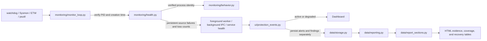

## 1. Entry points and process boundaries

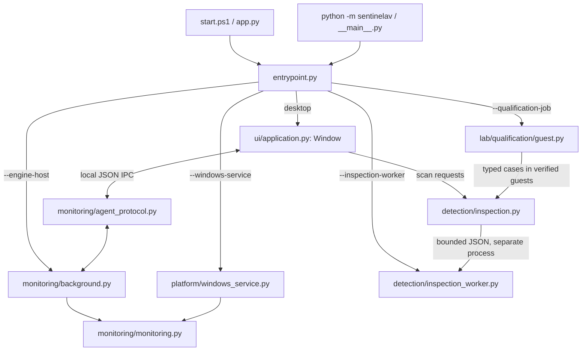

## 2. User clicks Scan

```mermaid
sequenceDiagram
    actor User
    participant Page as ui/design_scan.py
    participant Actions as ui/scan_actions.py
    participant QtWorker as ui/application_workers.py
    participant Parent as detection/inspection.py
    participant Child as detection/inspection_worker.py
    participant Engine as detection/engine.py + scan_flow.py
    participant Store as data/storage.py
    User->>Page: Choose quick/custom scan
    Page->>Actions: start_scan(roots, kind)
    Actions->>QtWorker: Pass resource root, options and exclusions
    QtWorker->>Parent: scan(roots)
    Parent->>Child: Bounded JSON request
    Note over Parent,Child: worker_limits.py enforces process/memory limits;<br/>inspection_protocol.py supplies shared byte limits
    Child->>Engine: Analyze file identities and content
    Engine-->>Child: Findings, omissions and coverage
    Child-->>Parent: JSON response
    Parent-->>QtWorker: Scan result
    QtWorker-->>Actions: Progress / completed / failed signals
    Actions->>Store: Save history on GUI thread
    Actions-->>Page: Update progress and results
```

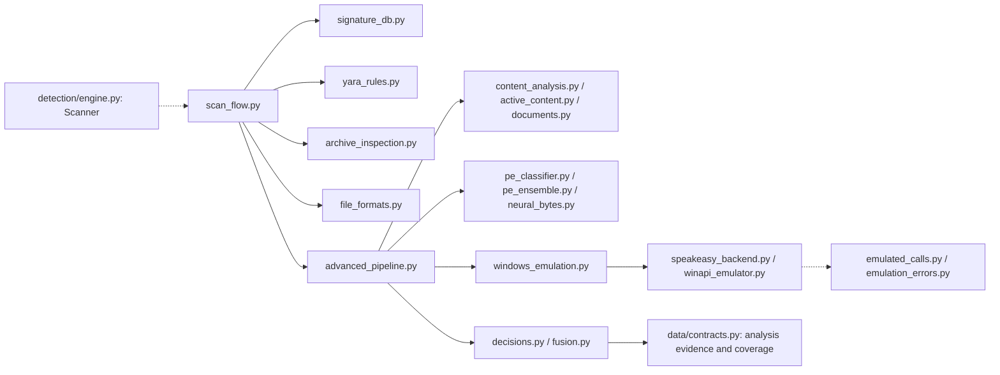

## 3. Continuous protection and App Changes

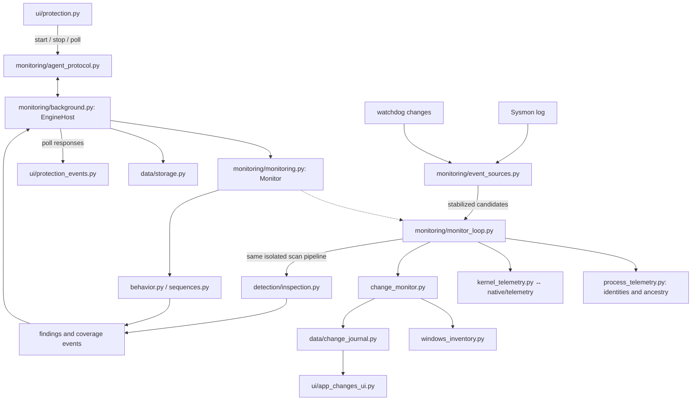

`monitoring/app_changes.py` remains the public import gateway to inventory and
change-monitoring code. It does not run a second implementation.

## 4. Reviewed response and recovery

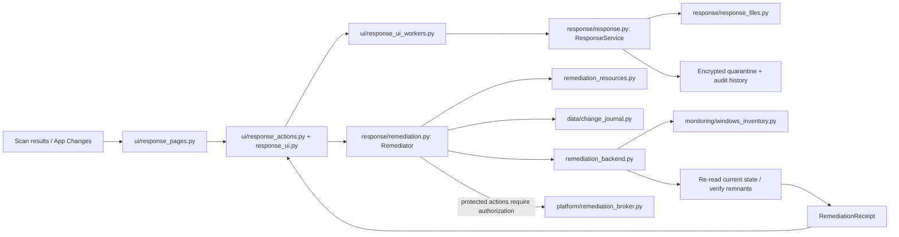

## 5. Signed update flow

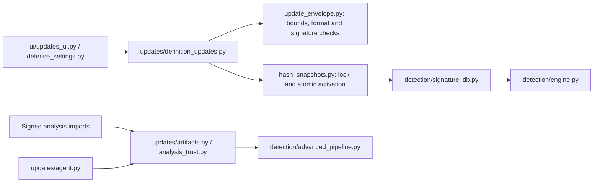

## 6. Evaluation harness: host and guest stay separate

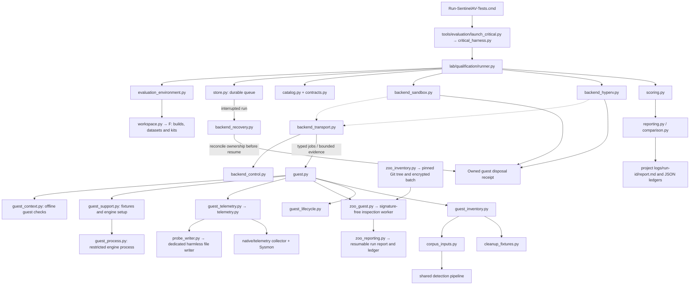

The public `backends.py` gateway exports the backend classes; their implementations
live in the focused `backend_*` files. This is a code interaction map, not a claim
that every qualification track has passed.

## 7. How UI files compose one window

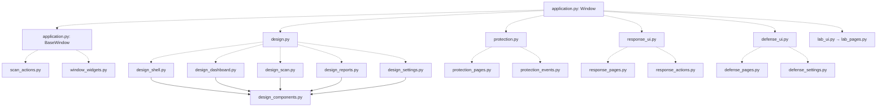

Page mixins operate on the same `Window` instance. Shared controls and state are
initialized by `BaseWindow`; feature hooks continue through `super()`. Workers
emit signals back to the UI, which owns its SQLite connection.

## 8. Optional native integrations and their boundaries

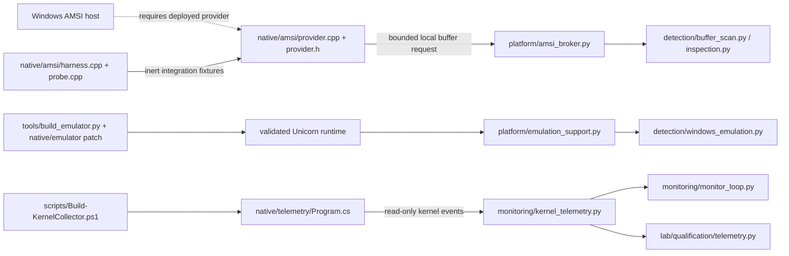

Native deployment and actual collection still have their own permission and
validation gates. This refactor does not change those requirements.

## 9. Detailed module interactions

Expand a package below to follow its actual first-party imports. These edges
mean **imports/uses**, including imports inside functions; they do not imply
startup execution order. External libraries and vendor code are omitted.

<details><summary>data: actual module imports</summary>

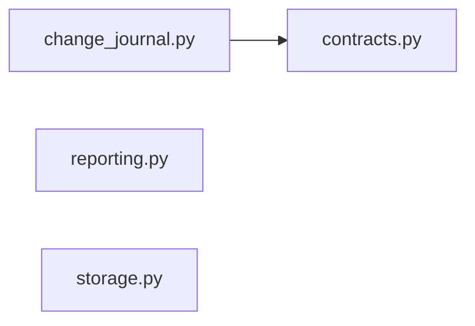

</details>

<details><summary>detection: actual module imports</summary>

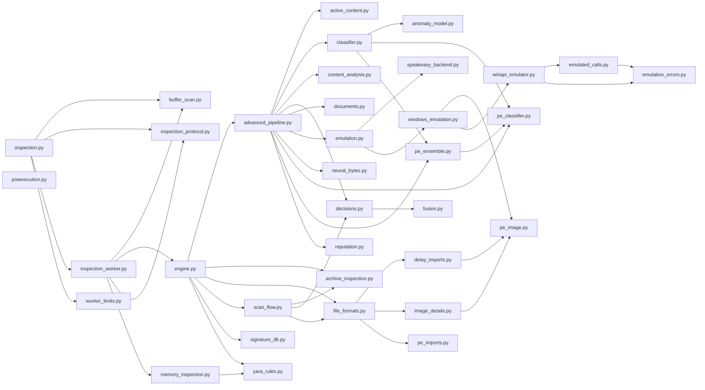

</details>

<details><summary>monitoring: actual module imports</summary>

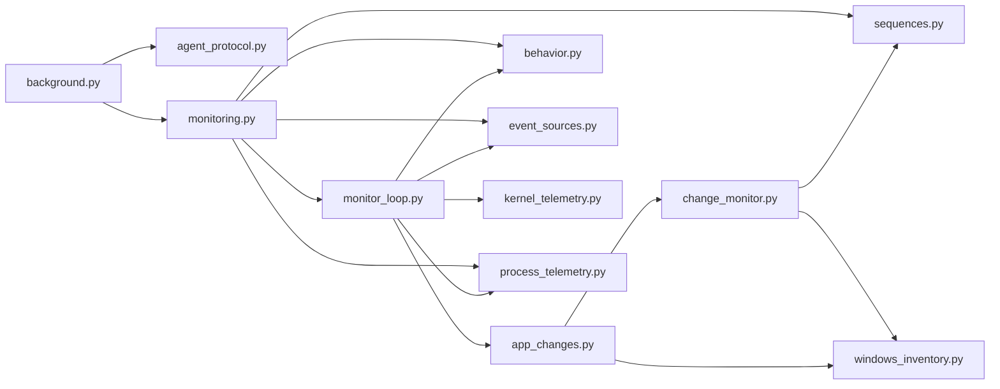

</details>

<details><summary>response: actual module imports</summary>

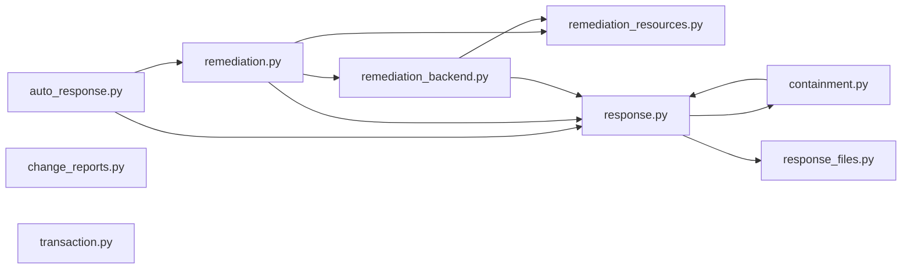

</details>

<details><summary>platform: actual module imports</summary>

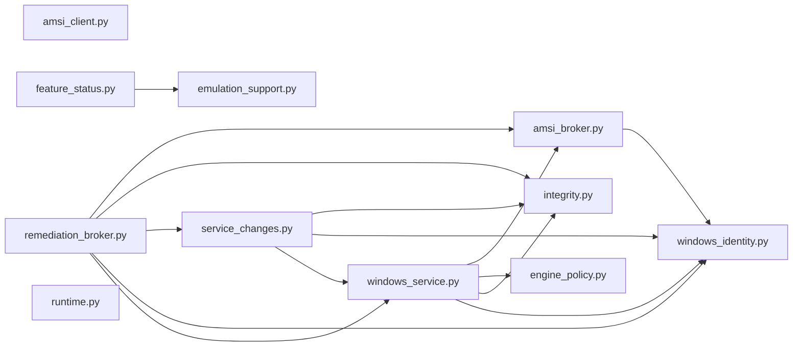

</details>

<details><summary>updates: actual module imports</summary>

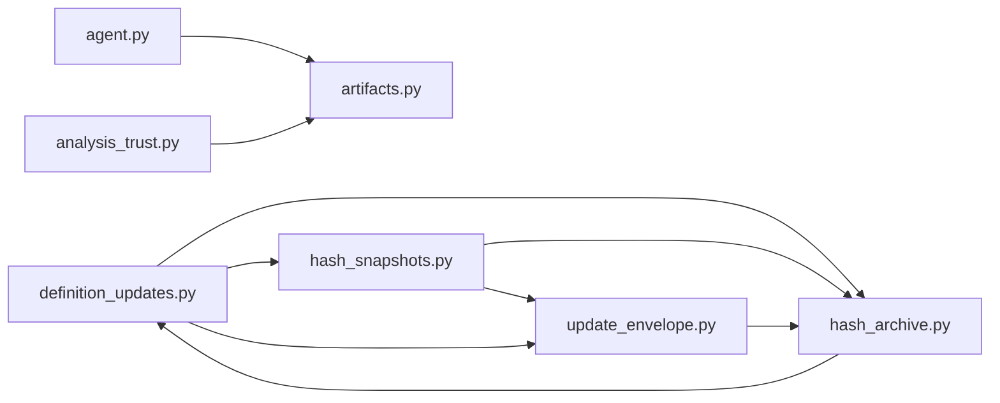

</details>

<details><summary>ui: actual module imports</summary>

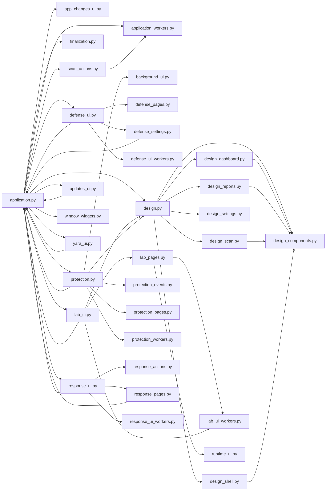

</details>

<details><summary>lab: actual module imports</summary>

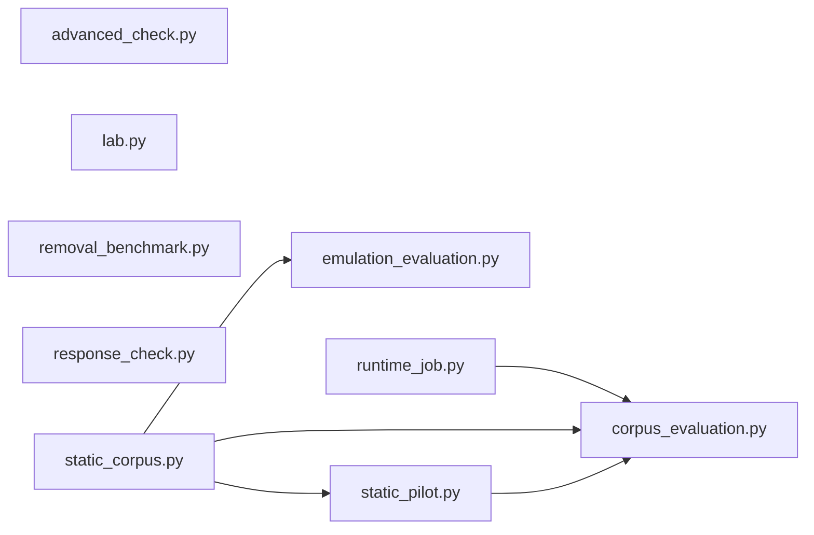

</details>

<details><summary>lab.qualification: actual module imports</summary>

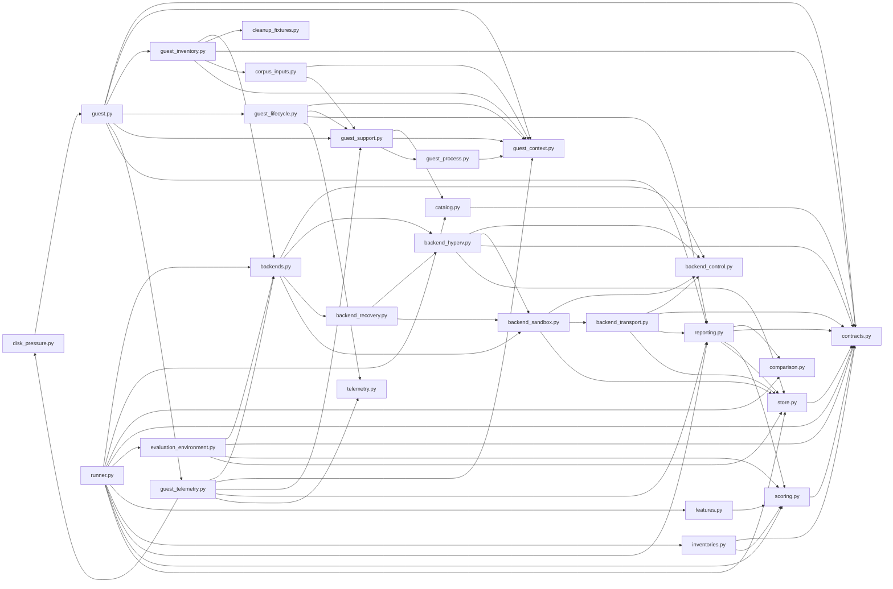

</details>

<details><summary>tools.feeds: CLI imports and their source modules</summary>

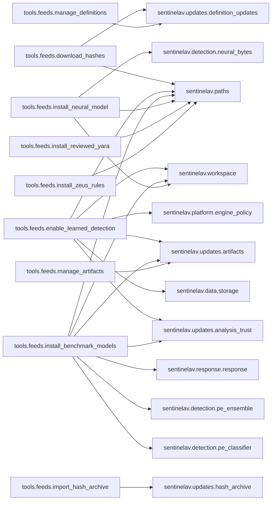

</details>

<details><summary>tools.evaluation: CLI imports and their source modules</summary>

```mermaid
flowchart LR
  t0["sentinelav.data.storage"]
  t1["sentinelav.detection.anomaly_model"]
  t2["sentinelav.detection.classifier"]
  t3["sentinelav.detection.engine"]
  t4["sentinelav.detection.fusion"]
  t5["sentinelav.detection.pe_classifier"]
  t6["sentinelav.detection.pe_ensemble"]
  t7["sentinelav.lab.corpus_evaluation"]
  t8["sentinelav.lab.lab"]
  t9["sentinelav.lab.qualification.backends"]
  t10["sentinelav.lab.qualification.runner"]
  t11["sentinelav.lab.qualification.store"]
  t12["sentinelav.lab.removal_benchmark"]
  t13["sentinelav.lab.runtime_job"]
  t14["sentinelav.lab.static_corpus"]
  t15["sentinelav.lab.static_pilot"]
  t16["sentinelav.monitoring.behavior"]
  t17["sentinelav.monitoring.monitoring"]
  t18["sentinelav.paths"]
  t19["sentinelav.platform.emulation_support"]
  t20["sentinelav.platform.engine_policy"]
  t21["sentinelav.response.containment"]
  t22["sentinelav.response.response"]
  t23["sentinelav.updates.artifacts"]
  t24["sentinelav.workspace"]
  t25["tools.evaluation.acquire_corpus"]
  t26["tools.evaluation.acquire_features"]
  t27["tools.evaluation.acquire_pilot"]
  t28["tools.evaluation.aggregate_signature_free"]
  t29["tools.evaluation.audit_learned_zoo"]
  t30["tools.evaluation.benchmark"]
  t31["tools.evaluation.calibrate_static"]
  t32["tools.evaluation.compare_removal"]
  t33["tools.evaluation.critical_harness"]
  t34["tools.evaluation.evaluate_behavior"]
  t35["tools.evaluation.evaluate_benign"]
  t36["tools.evaluation.evaluate_corpus"]
  t37["tools.evaluation.evaluate_coverage"]
  t38["tools.evaluation.evaluate_published_ensemble"]
  t39["tools.evaluation.inspect_corpus_metadata"]
  t40["tools.evaluation.inspect_zeus_rule_sources"]
  t41["tools.evaluation.launch_critical"]
  t42["tools.evaluation.prepare_features"]
  t43["tools.evaluation.prepare_signature_free"]
  t44["tools.evaluation.process_tree_response"]
  t45["tools.evaluation.run_guest_job"]
  t46["tools.evaluation.run_learned_zoo"]
  t47["tools.evaluation.setup_lab_telemetry"]
  t48["tools.evaluation.train_classifier"]
  t49["tools.evaluation.train_pe_model"]
  t50["tools.evaluation.verify_frozen_emulator"]
  t51["tools.evaluation.verify_learned_package"]
  t25 --> t14
  t25 --> t18
  t25 --> t22
  t25 --> t24
  t26 --> t24
  t27 --> t15
  t27 --> t18
  t27 --> t22
  t27 --> t24
  t28 --> t7
  t28 --> t23
  t28 --> t24
  t29 --> t46
  t30 --> t3
  t30 --> t17
  t30 --> t18
  t31 --> t1
  t32 --> t12
  t32 --> t23
  t32 --> t24
  t33 --> t9
  t33 --> t10
  t33 --> t11
  t33 --> t18
  t34 --> t8
  t34 --> t16
  t34 --> t18
  t35 --> t3
  t35 --> t18
  t35 --> t20
  t35 --> t24
  t36 --> t7
  t37 --> t7
  t37 --> t18
  t37 --> t20
  t37 --> t24
  t38 --> t6
  t38 --> t18
  t38 --> t22
  t38 --> t23
  t38 --> t24
  t39 --> t14
  t41 --> t33
  t42 --> t24
  t42 --> t26
  t43 --> t4
  t43 --> t7
  t43 --> t18
  t43 --> t23
  t43 --> t24
  t44 --> t0
  t44 --> t18
  t44 --> t21
  t44 --> t22
  t44 --> t23
  t45 --> t13
  t45 --> t23
  t46 --> t14
  t46 --> t22
  t46 --> t24
  t47 --> t9
  t47 --> t11
  t47 --> t18
  t47 --> t24
  t48 --> t2
  t48 --> t23
  t49 --> t5
  t49 --> t24
  t50 --> t19
  t51 --> t6
  t51 --> t18
  t51 --> t23
  t51 --> t24
```

</details>
